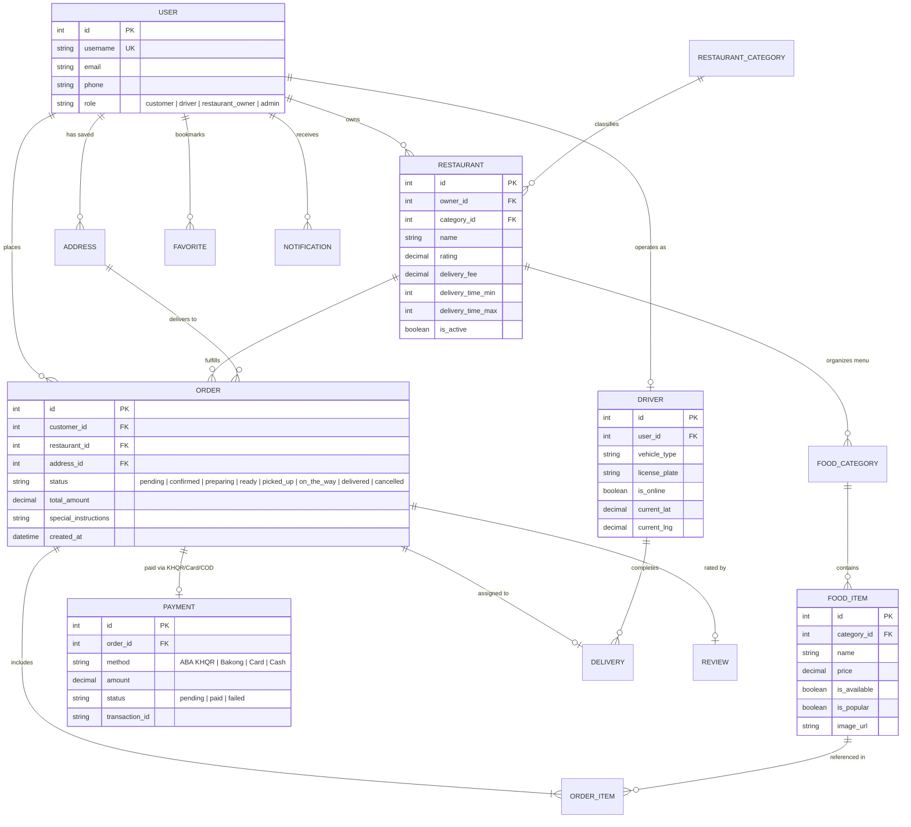

# FoodGo v2.0 — Database Architecture & ER Diagram (`Database/`)

**Course / Group**: AUB Batch 09 • Year 3 • Semester 1 • Group 7 (`aub-batch-09-y3-s1-m-g7-Food-Delivery-App`)  
**Database Engine**: SQLite 3 (`db.sqlite3`) / PostgreSQL-compatible SQL (`foodgo_schema_and_seed.sql`)  
**ORM**: Django 5.1 ORM (`foodgo-server/core/models.py`)

---

## Included Files
- `db.sqlite3` — Pre-migrated and seeded SQLite database containing 7 Cambodian & international restaurants, 23 authentic food items, categories, addresses, customer, delivery driver (`driver_sokha`), and partner accounts.
- `foodgo_schema_and_seed.sql` — Full SQL DDL schema + `INSERT` seed statements exported directly from `db.sqlite3`.
- `DATABASE_ER_DIAGRAM.md` — Entity-Relationship diagram and table reference.

---

## Entity-Relationship Diagram (ERD)



---

## Restoring or Resetting the Database

### Option 1: Using Django Management Command (Recommended)
```bash
cd foodgo-server
./venv/bin/python manage.py migrate
./venv/bin/python manage.py seed_data
```

### Option 2: Importing SQL Dump into SQLite
```bash
sqlite3 foodgo_restored.sqlite3 < Database/foodgo_schema_and_seed.sql
```
