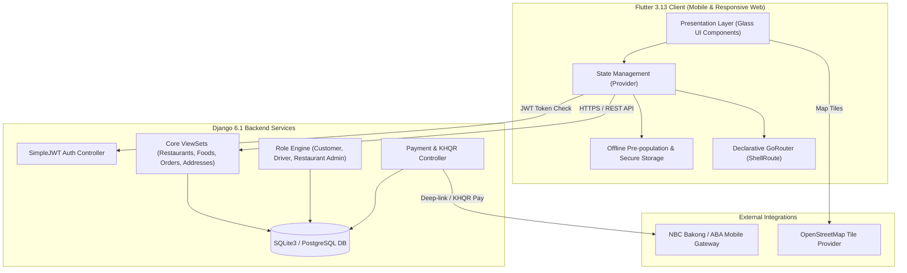

# FoodGo v2.0 — System Architecture & Technical Specifications

**Architecture Paradigm**: Decoupled Client-Server (REST API + Reactive Client)  
**Primary Clients**: Flutter Mobile (Android/iOS) + Responsive Flutter Web  
**Primary Backend**: Python Django 6.1 + Django REST Framework + SimpleJWT  
**Payment Backbone**: National Bank of Cambodia (NBC) Bakong KHQR Standard  

---

## 1. High-Level System Architecture Diagram

---

## 2. Data Flow & Security Model

### 2.1 Authentication & Session Life Cycle
1. **Credentials Dispatch**: Client submits `username`/`email` and `password` to `/api/token/` or registers via `/api/auth/register/`.
2. **JWT Issuance**: Server returns a pair of tokens:
   - `access` token (lifetime: 1 day, stored in Secure Storage with SharedPreferences fallback).
   - `refresh` token (lifetime: 7 days).
3. **Session Rehydration**:
   - On app startup, `AuthProvider.checkAuthStatus()` retrieves the token with an 800ms non-blocking timeout.
   - Profile verification occurs via `unawaited(fetchProfile())` in the background, preventing splash freeze.

### 2.2 KHQR Payment Processing Flow
1. **Checkout Calculation**: Total amount is computed with item subtotal, delivery fee (waived if $\ge \$15.00$), and optional driver tip.
2. **QR Code Matrix Generation**: `GlassQrPayModal` draws an authentic NBC Bakong compliant QR code with USD/KHR toggle (`1 USD = 4,100 ៛`).
3. **Payment State Transition**:
   - Order created in backend with `status='confirmed'`.
   - Payment record bound with `status='paid'` and `transaction_id`.
   - Push/In-app notification dispatched to kitchen.
