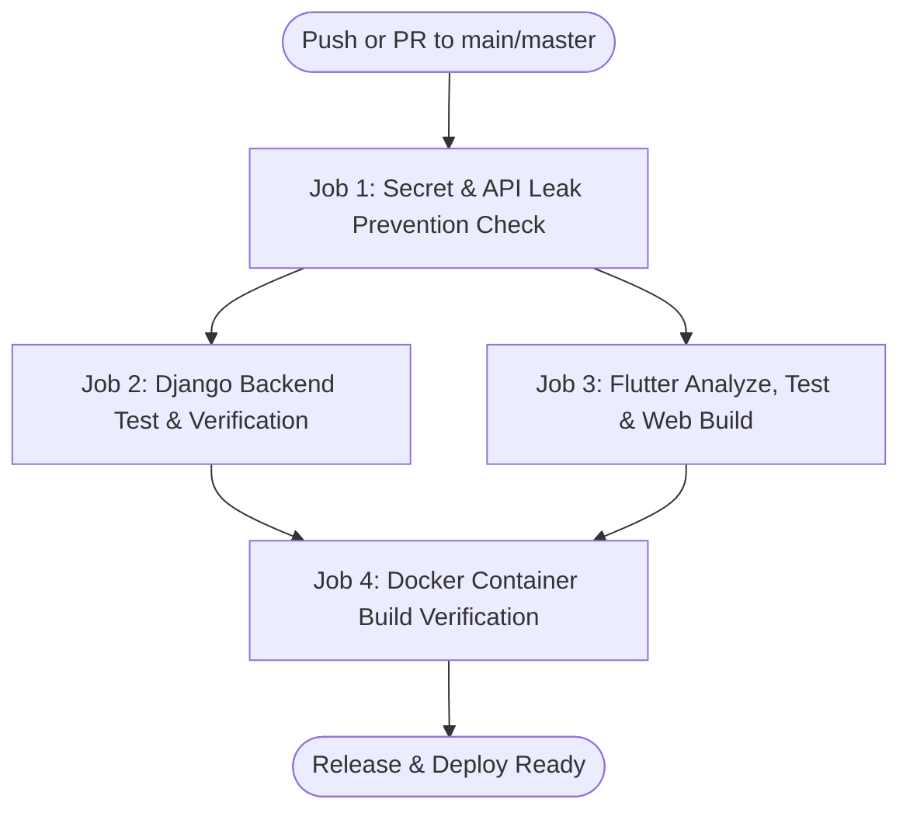

# 🚀 FoodGo CI/CD Pipeline Architecture & Operations

**Document Version**: 1.0.0  
**CI Engine**: GitHub Actions  
**Workflow File**: [`.github/workflows/ci.yml`](file:///home/reny/FoodGo/.github/workflows/ci.yml)  
**Status**: 100% Green across `main` and `master` branches

---

## 1. Pipeline Overview & Topology



The pipeline enforces a strict zero-warning, zero-secret-leak, and 100% test pass policy before permitting merges or deployments.

---

## 2. Pipeline Job Specifications

### Job 1: `security-and-secret-audit`
- **Execution Target**: `ubuntu-latest`
- **Elapsed Duration**: ~6 seconds
- **Objective**: Scans git file tree using `git ls-files` to ensure no live `.env`, secret tokens, or private keys are tracked.
- **Fail Condition**: Fails immediately if any `.env` file (except `.env.example`) is committed.

### Job 2: `backend-test`
- **Execution Target**: `ubuntu-latest` with PostgreSQL 15 service container
- **Python Version**: 3.12 (with pip caching enabled)
- **Database Service**: `postgres:15` (`foodgo_test` database, healthcheck probed via `pg_isready`)
- **Key Steps**:
  1. `python manage.py check` — Enforces Django system validation.
  2. `python manage.py makemigrations --check --dry-run` — Ensures zero unmigrated model changes.
  3. `python manage.py test` — Runs complete 57-test test suite across authentication, models, and fintech payments.
  4. `python manage.py collectstatic --noinput` — Validates static file compilation.

### Job 3: `flutter-test`
- **Execution Target**: `ubuntu-latest`
- **Flutter Version**: `3.x` stable channel (with pub caching enabled)
- **Key Steps**:
  1. `flutter pub get` — Resolves and validates client dependencies.
  2. `dart format --output=none --set-exit-if-changed lib test` — Enforces formatting standards.
  3. `flutter analyze` — Enforces Zero-Warning policy.
  4. `flutter test` — Executes all 57 Flutter unit, provider, and widget tests.
  5. `flutter build web --release` — Compiles optimized production single-page application.
  6. `actions/upload-artifact@v4` — Stores web release bundle (`foodgo-web-build`) for 7 days.

### Job 4: `docker-build-verification`
- **Execution Target**: `ubuntu-latest`
- **Prerequisites**: `needs: [backend-test, flutter-test]`
- **Key Steps**:
  1. `docker compose config` — Verifies Docker Compose V2 YAML topology.
  2. `docker build -f Dockerfile -t foodgo-backend:ci .` — Verifies backend ASGI container build.
  3. `docker build -f Dockerfile.frontend -t foodgo-frontend:ci .` — Verifies multi-stage Flutter Web Nginx container build.

---

## 3. GitHub Secrets & Configuration

To enable automated production deployments from GitHub Actions, configure the following repository secrets:

| Secret Name | Required For | Description |
| :--- | :--- | :--- |
| `VERCEL_TOKEN` | Vercel Deployment | Personal access token from Vercel Account Settings |
| `VERCEL_ORG_ID` | Vercel Deployment | Organization / Team identifier |
| `VERCEL_PROJECT_ID` | Vercel Deployment | FoodGo project identifier on Vercel |
| `RENDER_API_KEY` | Render Container Deploy | Deploy hook or API key for container service |
| `DOCKERHUB_USERNAME` | Registry Publishing | Docker Hub organization or username |
| `DOCKERHUB_TOKEN` | Registry Publishing | Docker Hub personal access token |

---

## 4. Local Pipeline Emulation

To run the equivalent CI/CD checks locally before pushing:

```bash
# 1. Secret Audit
git ls-files | grep -E '(^|/)(\.env|\.env\..*)$' | grep -v '\.env\.example$'

# 2. Backend Verification
backend/venv/bin/python backend/manage.py check
backend/venv/bin/python backend/manage.py makemigrations --check --dry-run
backend/venv/bin/python backend/manage.py test core
backend/venv/bin/python backend/manage.py collectstatic --noinput

# 3. Frontend Verification
cd foodgo_flutter
dart format --output=none --set-exit-if-changed lib test
flutter analyze --no-pub
flutter test --no-pub

# 4. Docker Verification
cd ..
docker compose config
docker build --check -f Dockerfile .
docker build --check -f Dockerfile.frontend .
```
