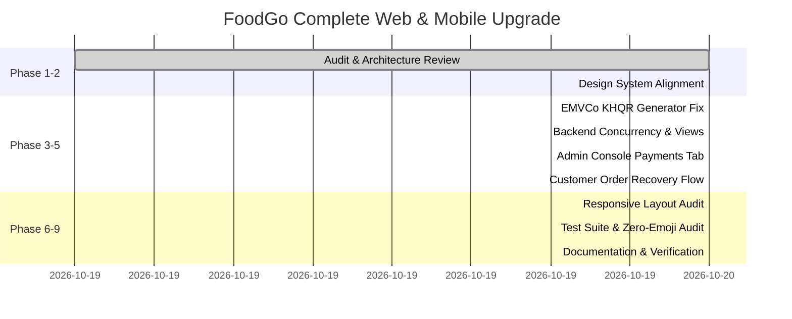

# FoodGo — Implementation Roadmap & Execution Plan

**Project**: [Ratanazen/FoodGo](https://github.com/Ratanazen/FoodGo)  
**Date**: October 20, 2026  
**Status**: In Progress  

---

## 1. Roadmap Overview

---

## 2. Sprint Milestones

### Milestone 1 — Core Banking & EMVCo Compliance
- [x] Create `backend/core/payments/utils.py` implementing standard TLV builder and CRC16-CCITT algorithm.
- [x] Update `backend/core/payments/aba.py` with real CRC16 and valid TLV format.
- [x] Update `backend/core/payments/acleda.py` with real CRC16 and valid TLV format.
- [x] Refactor `backend/core/payments/bakong.py` to use shared utilities.

### Milestone 2 — Backend Concurrency, State Machine & Admin Payments API
- [x] Wrap `CreatePaymentView` in `select_for_update()` and `transaction.atomic()`.
- [x] Wrap `BaseCallbackView` in `select_for_update()` and `transaction.atomic()` for strict idempotency.
- [x] Expand `PaymentStatusView` to handle `PAID`, `EXPIRED`, `FAILED`, `CANCELLED`.
- [x] Fix `status='PAID'` revenue calculation in `AdminAnalyticsView`.
- [x] Implement `AdminPaymentViewSet` with search, filter, and refund action in `backend/core/admin_views.py`.
- [x] Register `admin/payments` route in `backend/core/urls.py`.

### Milestone 3 — Administrator Console Payments Dashboard
- [ ] Update `foodgo_flutter/lib/providers/admin_provider.dart` with payment state and API methods (`fetchPayments`, `refundPayment`).
- [ ] Add 6th tab (**Payments**) to `AdminDashboardScreen` with metrics, search, status filter chips, payment list, and refund modal.

### Milestone 4 — Customer Experience & Unpaid Order Recovery
- [ ] Add "Pay with KHQR" action button on unpaid order cards in `orders_screen.dart`.
- [ ] Harden `QRPaymentScreen` responsive container layout, countdown timer, and polling shutdown on terminal state.

### Milestone 5 — Automated Testing Suite & CI/CD
- [ ] Add backend unit tests in `backend/core/tests_payment.py` for CRC16 calculation, concurrency, webhook validation, and refund.
- [ ] Update `backend/core/tests_admin.py` for `status='PAID'` and `AdminPaymentViewSet`.
- [ ] Add Flutter tests in `foodgo_flutter/test/payment_test.dart` for payment model and admin payments tab.

### Milestone 6 — Documentation & Final Release
- [ ] Create `docs/user-flows.md`, `docs/payment-flow.md`, and `docs/payment-provider-setup.md`.
- [ ] Update `README.md`, `.env.example`, `walkthrough.md`, and `task.md`.
- [ ] Verify 100% test pass rate, clean analyzer (`flutter analyze --no-pub`), and zero-emoji compliance.
