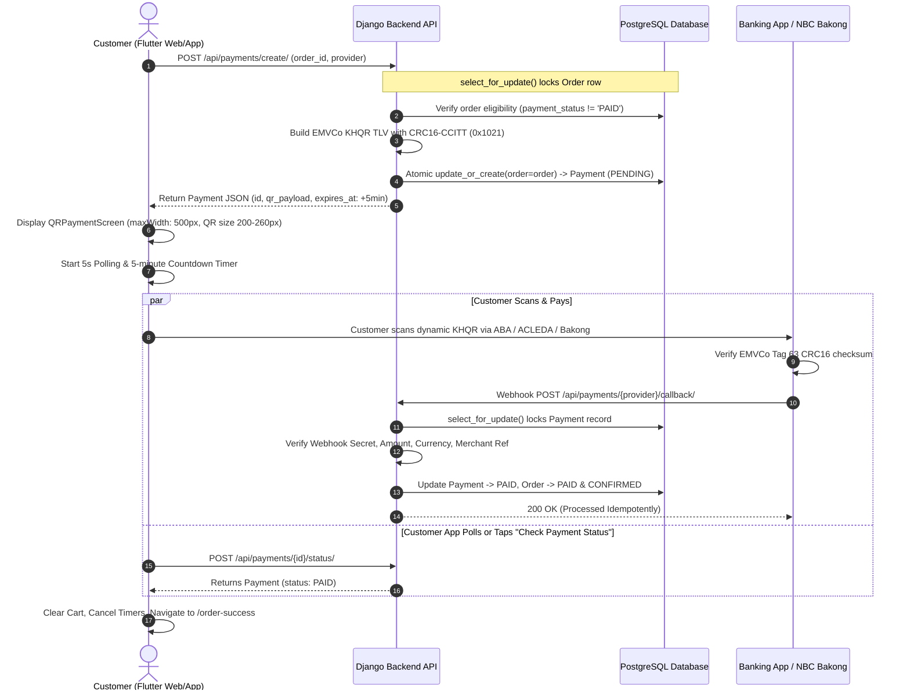
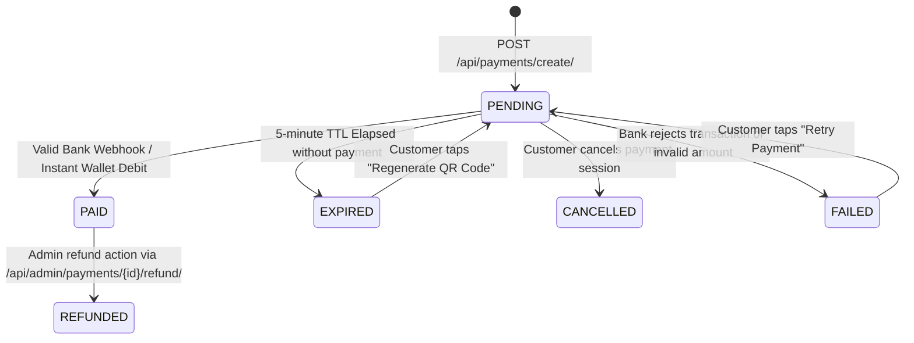

# FoodGo KHQR Payment Flow & Architecture Specification

## 1. Executive Summary

FoodGo employs a high-reliability, banking-grade dynamic KHQR payment engine adhering strictly to the **National Bank of Cambodia (NBC) KHQR EMVCo Merchant-Presented Mode Specification**.

All payment creation, cryptographic CRC16 verification, webhook authorization, and status mutations are authoritative on the Django backend. The Flutter web and mobile applications consume backend-generated payloads, rendering responsive, user-friendly payment screens without ever having authority to mutate payment status directly.

---

## 2. End-to-End Sequence Diagram

---

## 3. State Machine & Lifecycle

The payment engine transitions through well-defined lifecycle states:

### State Definitions
- **PENDING**: Initial state upon KHQR generation. Has a 5-minute time-to-live (`expires_at = now + 5 min`).
- **PAID**: Confirmed payment via authentic bank callback or wallet balance deduction. Order status becomes `confirmed`, and customer cart is cleared.
- **EXPIRED**: 5-minute window passed without payment. Polling stops immediately. Customer can regenerate a fresh code.
- **CANCELLED**: Explicitly aborted by user. Timers cancel immediately; background responses are discarded.
- **FAILED**: Rejected due to insufficient funds or banking gateway error.
- **REFUNDED**: Processed by authorized administrator (`admin` / `staff`). Automatically resets order status and records an immutable `AuditLog` entry.

---

## 4. EMVCo KHQR Payload Structure

KHQR is built using standard Tag-Length-Value (TLV) encoding:

| Tag | Name | Example Value | Description |
|---|---|---|---|
| `00` | Payload Format Indicator | `01` | Version indicator (always `01`) |
| `01` | Point of Initiation | `12` | `12` represents Dynamic QR (one-time payment) |
| `29` / `30` | Merchant Account Information | `0016abaakhppxxx@abaa` | Bank GUID subtag `00` & bill number subtag `01` |
| `52` | Merchant Category Code | `5812` | Standard MCC (e.g. Restaurants `5812`) |
| `53` | Transaction Currency | `840` / `116` | ISO 4217 (`840` = USD, `116` = KHR) |
| `54` | Transaction Amount | `15.50` | Formatted to 2 decimal places |
| `58` | Country Code | `KH` | Cambodia ISO 3166-1 alpha-2 |
| `59` | Merchant Name | `FoodGo Restaurant` | Registered business name |
| `60` | Merchant City | `Phnom Penh` | Operating city |
| `62` | Additional Data Field | `0115FG-ABA-101-1234` | Subtag `01` (Bill Number / Reference) |
| `63` | Checksum (CRC16) | `29B1` | 4-character hex CRC16-CCITT calculated over all preceding characters |

### Mathematical CRC16-CCITT Algorithm
Implemented in `backend/core/payments/utils.py`:
- **Polynomial**: `0x1021` ($x^{16} + x^{12} + x^5 + 1$)
- **Initial Value**: `0xFFFF`
- **Output**: 4-digit uppercase hexadecimal string (e.g. `29B1`)

---

## 5. Concurrency & Security Safeguards

1. **Row-Level Locking**:
   - `Order.objects.select_for_update()` ensures that concurrent payment requests for the same order are serialized without race conditions.
   - `Payment.objects.select_for_update()` in callback handlers guarantees idempotent execution when banks send duplicate webhooks.
2. **Authoritative Backend Pricing**:
   - Total amount, currency, and items are strictly calculated on the backend from `Order` records; frontend requests cannot override amounts.
   - Webhook amounts must match stored payment amounts exactly (preventing underpayment attacks).
3. **Webhook Authentication**:
   - Webhook endpoints require the `X-Webhook-Secret` header matching `PAYMENT_WEBHOOK_SECRET` in production environments.
4. **Late Async Response Protection**:
   - In Flutter `QRPaymentScreen`, if a user cancels or the countdown expires, polling and countdown timers cancel immediately.
   - Async callback returns check `if (_currentPayment.isCancelled) return;` to prevent race conditions from reverting cancelled states.

---

## 6. Frontend Responsive Layout Specifications

- **Desktop & Tablet Viewport**: Centered inside a `ConstrainedBox(maxWidth: 500)` container to eliminate excessive stretching on widescreen monitors.
- **QR Code Container**:
  - Dynamically calculated: `final qrSize = (screenWidth * 0.55).clamp(200.0, 260.0);`
  - High-contrast pure white container with a 16-20px quiet zone ensuring instant camera focus.
- **3-Step Instruction Card**: Clear, numbered step guides with vector badge icons.
- **Copy KHQR Payload & Debug Accordion**: Collapsible drawer showing raw EMVCo payload for debugging and clipboard copy.
