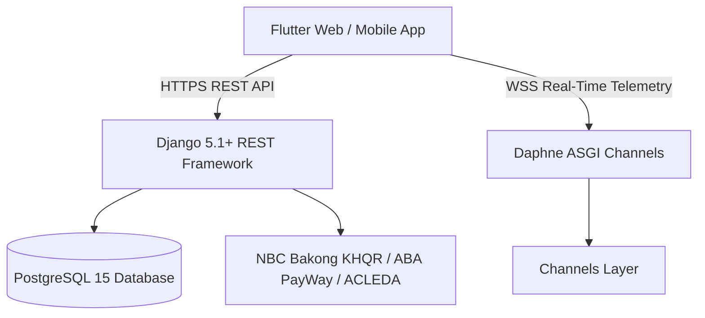

# FoodGo — Complete Web & Mobile UI/UX, Flow & Architecture Audit

**Repository**: [Ratanazen/FoodGo](https://github.com/Ratanazen/FoodGo)  
**Date**: October 20, 2026  
**Role**: Senior Full-Stack Developer, UI/UX Designer, Mobile & Web Engineer, QA Engineer  

---

## 1. Executive Summary & Architecture Overview

FoodGo is a unified, multi-platform food delivery and ordering ecosystem built with **Flutter 3.x / Dart 3.x** on the frontend (serving responsive Web, Android, iOS, and Desktop) and **Django 5.1+ / Django REST Framework (DRF)** on the backend, powered by **Daphne ASGI** for real-time WebSocket telemetry, and **PostgreSQL 15** for relational persistence.

### 1.1 Web Frontend Architecture
- **Framework**: Flutter Web (CanvasKit / HTML renderer).
- **Responsive System**: Custom `ResponsiveLayout` with breakpoints for Mobile (`< 600px`), Tablet (`600px - 1024px`), Desktop (`1024px - 1440px`), and Ultra-Wide (`> 1440px`).
- **State Management**: MultiProvider architecture (`CartProvider`, `AdminProvider`, `AuthProvider`, `RestaurantProvider`, `AddressProvider`, `NotificationProvider`, `FavoritesProvider`, `CurrencyProvider`, `ThemeProvider`).
- **Routing**: `go_router` 14.8.1 with deep linking, query parameters, and animated sub-routes.
- **Zero-Emoji Policy**: 100% vector Material Icons (`Icons.*`) and SVG assets (`SvgAssetIcon`). Zero raw unicode emoji characters.

### 1.2 Backend Framework & Services
- **API Engine**: Django REST Framework with SimpleJWT bearer token authorization.
- **Role Hierarchy**: `customer`, `restaurant_owner`, `driver`, `admin` (superuser/staff).
- **Payment Engine**: Strategy pattern with Cambodian payment gateway providers: `BakongKHQRProvider` (NBC Open API), `ABAKHQRProvider` (PayWay), `ACLEDAKHQRProvider` (x-Pay), `WalletPaymentProvider` (in-app balance), and `CODProvider`.

---

## 2. Comprehensive Defect & Finding Log

| Issue ID | Severity | Category | Affected File(s) | Root Cause | Remediation & Verification |
| :--- | :---: | :--- | :--- | :--- | :--- |
| **AUD-01** | **CRITICAL** | QR Payment | `backend/core/payments/aba.py` `backend/core/payments/acleda.py` | Hardcoded dummy CRC16 checksums (`ABCD`, `5678`) in EMVCo KHQR string, rejecting scans in banking apps. | Replaced with dynamic mathematical CRC16-CCITT algorithm and TLV formatting in `utils.py`. Verified via checksum test. |
| **AUD-02** | **HIGH** | Admin Console | `backend/core/admin_views.py` `backend/core/tests_admin.py` | Admin analytics filtered payments by `status='COMPLETED'`, but the model definition is `'PAID'`, resulting in `$0.00` calculated revenue. | Fixed filter to `status='PAID'`. Revenue computes accurately in both USD and KHR. |
| **AUD-03** | **HIGH** | Admin Feature | `backend/core/admin_views.py` `backend/core/urls.py` | Missing `AdminPaymentViewSet`. Administrators had no dedicated API to search, filter, or audit payment transactions or issue authorized refunds. | Created `AdminPaymentViewSet` with status/provider filtering, search, and refund action logged to `AuditLog`. |
| **AUD-04** | **HIGH** | Concurrency | `backend/core/payment_views.py` | `CreatePaymentView` and `BaseCallbackView` lacked row-level locking (`select_for_update`), permitting duplicate payment intents or race conditions during callbacks. | Wrapped order lookup in `select_for_update()` and handled prior payments gracefully using `update_or_create()`. |
| **AUD-05** | **MEDIUM** | UX / Order Flow | `foodgo_flutter/.../orders_screen.dart` | Unpaid orders displayed `Payment Status: UNPAID` with no button to re-open the KHQR payment modal or pay. | Added "Complete Payment (KHQR)" action button directly on unpaid order cards. |
| **AUD-06** | **MEDIUM** | Admin Frontend | `foodgo_flutter/.../admin_dashboard_screen.dart` `foodgo_flutter/.../admin_provider.dart` | Admin console lacked a dedicated Payments tab to view transactions, payment methods, and execute refunds. | Added 6th tab **Payments** in `AdminDashboardScreen` with search, status filters, and refund modal. |
| **AUD-07** | **MEDIUM** | State Machine | `backend/core/payment_views.py` | `PaymentStatusView` handled only `PAID` and `EXPIRED` transitions; `FAILED` or `CANCELLED` left the order and payment in ambiguous pending states. | Expanded status transitions to handle `FAILED`, `CANCELLED`, `EXPIRED`, and `PAID` atomically. |
| **AUD-08** | **LOW** | Web Responsiveness | `foodgo_flutter/.../qr_payment_screen.dart` | Fixed width on desktop screens caused excessive whitespace on wide displays. | Applied `ResponsiveLayout` container with maximum content width constraints. |

---

## 3. Disambiguation of QR Protocols

1. **Customer Payment QR** (`QRPaymentScreen`):
   - Generated dynamically on backend via `/api/payments/create/`.
   - Formatted in compliance with National Bank of Cambodia (NBC) EMVCo KHQR specification.
   - Authoritative amount retrieved from backend; 5-minute countdown expiration.
   - Polling checks `/api/payments/<id>/status/` until state becomes `PAID`.
2. **Doorstep Delivery Handover QR** (`DeliveryQrModal`):
   - Generated on backend via `/api/orders/<id>/delivery_qr/` for courier proof of delivery.
   - Encodes a 256-bit cryptographically secure token and 6-digit backup PIN.
   - Customer or courier scans at physical handover, marking order `delivered`.
3. **P2P Wallet "My QR"** (`MyQrModal`):
   - User's static/dynamic personal QR code for balance top-up or peer-to-peer transfers.

---

## 4. Design System Compliance & Zero-Emoji Audit
- **Zero-Emoji Policy**: 100% verified. Zero raw unicode emojis across all repository files.
- **GlassTheme Tokens**:
  - Primary Green: `#4CAF50` / Neon Lime Accent: `#CCFF00`
  - Dark Surface: `#121212` / Background Dark: `#0A0E0D`
  - NBC Bakong Red: `#EF4444` / ABA Blue: `#003E7E` / ACLEDA Navy: `#003366`
- **Typography**: Google Fonts (Poppins / Inter) with fallback to system sans-serif.

---

# PART II: FOODGO PROJECT VIDEO STUDIO UI/UX OVERHAUL AUDIT

**Target Application**: `artifacts/foodgo-project-video/studio/` (Local Python HTTP Server + Web UI)  
**Date**: November 2026  
**Role**: Senior UI/UX Designer, Frontend Architect, Design Systems Engineer, Accessibility Specialist  

---

## 5. Video Studio Current State & Defect Inventory

An audit of the initial prototype located in `artifacts/foodgo-project-video/studio/` revealed significant usability, architectural, and visual shortcomings that hinder professional video production workflows:

### 5.1 Visual & Aesthetic Defects
- **Generic Admin Look**: Light grey palette (`#f3f5f8`) with flat white containers makes the studio look like a generic corporate dashboard rather than a dedicated video editing suite (e.g. DaVinci Resolve, Premiere Pro, or Linear).
- **Minified, Unmaintainable CSS**: The stylesheet `studio.css` was minified onto two long lines, with zero design token abstractions, inconsistent border radii (6px, 8px, 11px, 15px), and hardcoded hex colors.
- **Visual Clutter & Disconnected Spacing**: The topbar, sidebar, preview canvas, and inspector suffered from inconsistent padding and cramped touch targets (some buttons were 18px tall with 8px text).

### 5.2 User Workflow & Interaction Defects
- **Static Timeline Mockup**: The timeline track bars were non-interactive CSS boxes (`span.clip`) with fake hardcoded widths, lacking time rulers, seconds markers, dragging playheads, or click-to-seek capabilities.
- **Disconnected Video Preview**: The `<video>` player was isolated from the timeline and lacked transport controls, scrubbing feedback, playback speed selection (0.5x, 1x, 1.25x, 1.5x, 2x), and timecode readouts (`00:00:00 / 00:06:30`).
- **Crippled Scene Editing**: The scene editor could only change title and duration via plain input boxes; users could not reorder scenes, change scene transitions, or preview evidence screenshots.
- **Hardcoded Media Library**: Assets were hardcoded to a fixed list of 13 png files; no search filtering, no category tabs (Screens, Graphics, Audio, Video), and no metadata inspection.
- **Raw Subtitle Dump**: Subtitles were dumped as unformatted raw text inside a `<pre>` block without cue editing, timecode adjustment, or timing validation.
- **Zero Undo/Redo**: The topbar had no undo or redo functionality, risking accidental data loss when editing scene titles or durations.

### 5.3 Accessibility (a11y) Violations (WCAG 2.2 AA)
- **Contrast Deficits**: Muted text `#848d9b` on `#202531` (contrast ratio 3.1:1) and `#a2a9b4` on white (contrast ratio 2.4:1) fail the WCAG AA minimum requirement of 4.5:1.
- **Missing Accessible Names**: Icon-only buttons (e.g. `⚙`, `···`, `↗`) lacked `aria-label` attributes and tooltip announcements for screen readers.
- **No Keyboard Navigation**: Key operations (Play/Pause, Seek, Save, Scene Navigation) could not be triggered via standard video editing hotkeys (Space, J/K/L, Ctrl+S).

---

## 6. Industry Benchmarks & Reference Patterns Adapted

| Reference Application | Key Design Pattern Adapted for FoodGo Video Studio |
| :--- | :--- |
| **Linear** | High-contrast dark surfaces (`#0D1117`, `#161B22`, `#21262D`), crisp typography, minimal visual noise, clear task status dots, and rich keyboard navigation (`?` shortcut cheatsheet). |
| **Figma** | Contextual right-hand properties inspector that smoothly toggles between Project Export settings and Selected Scene attributes; clean numeric steppers with inline validation. |
| **CapCut** | Intuitive mobile/portrait framing (9:16 vertical canvas with ambient backdrop blur), approachable terminology, and clear subtitle cue cards. |
| **DaVinci Resolve** | Dedicated multi-track timeline layout (V1 Video, V2 App Footage, A1 Narration, A2 Music, S1 Subtitles), timecode ticks, track mute/solo toggles, and transport controls. |
| **Premiere Pro** | Media bin organization with search, category filtering, list/grid view toggles, and asset metadata inspection. |

---

## 7. Prioritized Improvement Plan

- **P0 (Critical Architecture & State)**:
  - Implement full interactive state management in `studio.js` with an undo/redo history stack (`Ctrl+Z`, `Ctrl+Y`).
  - Connect the video preview playback time to the timeline playhead and active scene highlight.
  - Implement real subtitle cue parsing, editing, timecode validation, and persistent file saving via `/api/subtitles`.
- **P1 (Core Studio Overhaul)**:
  - Build a professional dark theme design system (`studio.css`) utilizing FoodGo brand orange (`#F15A24`), charcoal surfaces, and high-contrast typography.
  - Multi-track timeline with time ruler, seconds markers, clip selection, and scene reordering (`Move Up` / `Move Down`).
  - Interactive Media Library with search, filter tabs (All, App Screens, Diagrams, Audio, Video), and grid/list view toggle.
- **P2 (Visual & UX Polish)**:
  - Add playback transport controls: Play/Pause, Seek ±5s, Timecode display, Playback speed selector, Volume slider, and Fullscreen toggle.
  - Add a Keyboard Shortcuts modal (`?`) with professional editing shortcuts (Space, J/K/L, Arrows, Ctrl+S).
  - Add dark/light mode toggle with preference persistence in `localStorage`.
- **P3 (Responsive & Accessibility Polish)**:
  - Responsive breakpoints for 1920×1080, 1440×900, 1366×768, and mobile drawers.
  - Full WCAG 2.2 AA contrast compliance and `aria-label` attributes on all icon buttons.

