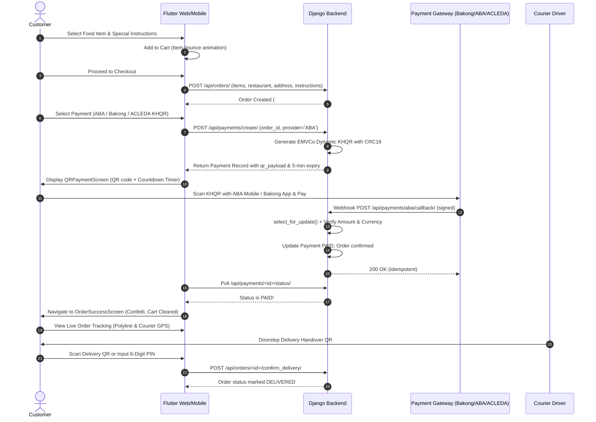
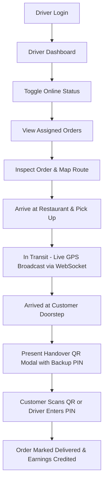
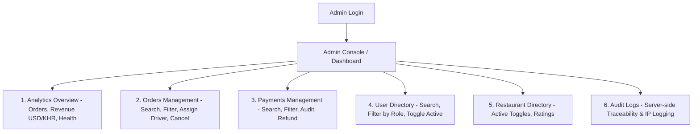

# FoodGo — End-to-End User Journeys & Flow Architecture

**Project**: [Ratanazen/FoodGo](https://github.com/Ratanazen/FoodGo)  
**Date**: October 20, 2026  
**Status**: Verified  

---

## 1. Customer Journey Flow

### 1.1 Recovery & Error Paths
- **Unpaid Order Resumption**: If a customer navigates away or loses connection during payment, they can visit `/orders`, locate the unpaid order, and tap **"Complete Payment (KHQR)"** to resume without placing duplicate orders.
- **QR Expiration**: When the 5-minute window expires, the countdown displays `Payment QR Expired`. The customer can tap **"Regenerate QR"** or return to checkout safely.
- **Insufficient Wallet Balance**: If paying via FoodGo Wallet and the balance is below the order total, an alert prompt directs the user to "My QR" top-up or an alternative KHQR payment method.

---

## 2. Driver Journey Flow

---

## 3. Administrator Journey Flow

### 3.1 Security & Fraud Prevention
- **Authorization**: All administrative routes enforce `IsAdminOrStaff` on the backend.
- **Server-Side Verification**: Administrators cannot arbitrarily flip payment status from unverified to paid without authoritative provider callbacks or banking reconciliation.
- **Audited Refunds**: Initiating a refund triggers provider refund APIs, reverts order payment status to `REFUNDED`, and generates an immutable record in `AuditLog` containing administrative user ID, timestamp, and client IP.
